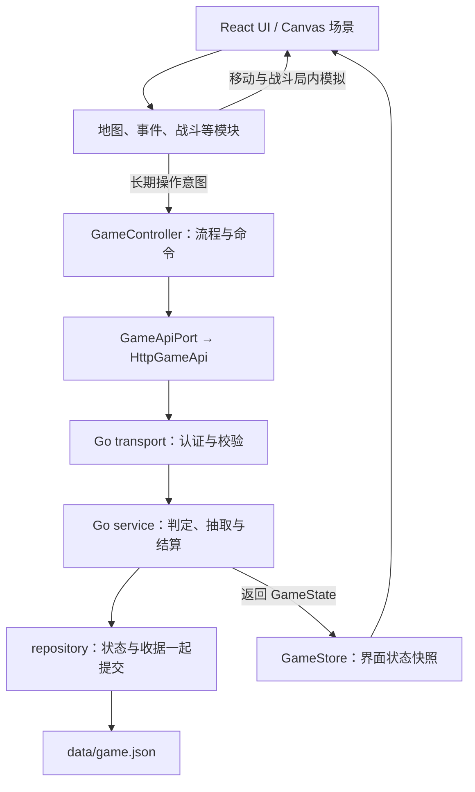

# 架构与文件目录

## 1. 技术与数据流

React + TypeScript + 原生 Canvas 2D；Go API；当前采用单进程 JSON 存档。不使用 Phaser。



移动、碰撞和逐帧战斗在前端运行；事件判定、抽奖、长期奖励和摆放经过 Go。商城和真实付费尚未实现，未来同样由服务端验证和发货。

## 2. 实际目录

以下从实际源码文件夹生成；node_modules、data、.runtime、output、tmp、构建和测试输出不入库，不列入源码树。预留空目录用 .gitkeep 保留。

```text
stray-kitty/
├─ deploy/  部署模板
├─ docs/  仅三份文档
│  ├─ ARCHITECTURE.md  架构、目录与接入
│  ├─ openapi.json  API 规范
│  └─ PRD.md  需求与分工
├─ scripts/  启动、生成与检查
├─ server/  Go 服务端
│  ├─ cmd/  服务入口
│  │  └─ api/  HTTP 启动
│  ├─ internal/  服务实现
│  │  ├─ domain/  状态、命令与错误
│  │  ├─ integrations/  外部集成
│  │  │  └─ payment/  支付渠道 · 预留
│  │  ├─ platform/  嵌入内容配置
│  │  ├─ repository/  单进程 JSON 文件事务
│  │  ├─ service/  长期规则、判定、奖励与结算
│  │  └─ transport/  请求、认证与参数检查
│  └─ migrations/  MySQL 结构 · 尚未接入
├─ tests/  自动验证
│  └─ e2e/  浏览器流程
├─ web/  浏览器前端
│  ├─ content/  独立内容数据
│  │  ├─ assets/  素材索引
│  │  ├─ battles/  关卡与波次
│  │  ├─ cats/  猫咪档案
│  │  ├─ economy/  经济配置 · 预留
│  │  ├─ events/  事件与选项
│  │  ├─ home/  家具与摆放位置
│  │  ├─ items/  道具
│  │  ├─ lottery/  奖池
│  │  ├─ maps/  地图与交互点
│  │  ├─ shop/  商品配置 · 预留
│  │  ├─ story/  章节与对话
│  │  └─ tutorials/  操作提示
│  ├─ public/  静态资源
│  │  └─ assets/  图片、动画、声音与字体
│  └─ src/  运行代码
│     ├─ adapters/  具体运行能力
│     │  ├─ api/  HTTP 请求
│     │  ├─ canvas/  原生 Canvas 2D
│     │  ├─ payment/  支付动作 · 预留
│     │  ├─ platform/  输入与设备能力
│     │  ├─ storage/  浏览器会话与待确认请求
│     │  └─ telemetry/  本地诊断
│     ├─ app/  启动、装配与 GameController
│     ├─ config/  运行配置
│     ├─ contracts/  公共状态、命令与模块输入输出
│     ├─ core/  公共流程
│     │  ├─ flow/  阶段与命令检查
│     │  ├─ ports/  API 与会话存储接口
│     │  ├─ rules/  公共条件与资源判断
│     │  ├─ state/  GameStore 状态快照
│     │  └─ story/  剧情与任务
│     ├─ examples/  参考实现
│     │  └─ demo/  可替换的贯通 Demo
│     ├─ modules/  正式模块接入口
│     │  ├─ battle/  塔防 · 闫琦雯
│     │  ├─ cats/  猫咪档案、救援与成长
│     │  ├─ economy/  货币、扣费与奖励
│     │  ├─ events/  随机事件 · 余尧
│     │  ├─ home/  家园建设、摆放与互动
│     │  ├─ inventory/  道具与家具持有
│     │  ├─ lottery/  奖池、抽取与结果
│     │  ├─ map/  地图 · Jenny
│     │  └─ shop/  商品与购买 · 预留
│     ├─ shared/  通用工具 · 预留
│     └─ ui/  界面与样式 · 轩扬
├─ .dockerignore  容器构建排除
├─ .env.example  非秘密环境变量示例
├─ .gitattributes  换行与二进制规则
├─ .gitignore  本地生成文件排除
├─ .gitlab-ci.yml  检查与构建流水线
├─ 《小猫回家记：流浪猫王国》.md
├─ package-lock.json  锁定依赖
├─ package.json  依赖与工程命令
├─ playwright.config.ts  浏览器测试配置
└─ 启动开发.cmd  Windows 开发入口
```

## 3. 状态与模块边界

| 数据 | 放在哪里 |
| --- | --- |
| 长期进度：章节、任务标记、伙伴、资源、家具、摆放、首次奖励与阶段 | 服务端 GameState；前端 GameStore 只保存返回快照 |
| 局内状态：坐标、镜头、敌人、生命、弹道、能量与计时 | 地图／战斗模块内部 |
| 当前面板、选中家具、按钮状态 | React UI |
| 剧情、地图、事件、猫咪、关卡、家具、道具与奖池定义 | web/content |
| 会话与结果未知的原始请求 | adapters/storage；不作为权威存档 |

home 管建设与摆放，lottery 管抽奖，shop 管购买；economy 统一余额与结算，inventory 统一拥有状态。抽到／买到家具后再交 home 摆放。真实付费预留在前后端 payment 目录，本次没有支付实现。

## 4. 接入与分工

| 负责人 | 主要位置 | 输入 → 输出 |
| --- | --- | --- |
| 王浩哲 | core/story、core/flow、app；content/story | 状态与剧情节点 → 阶段、任务和跨模块衔接 |
| Jenny | modules/map；content/maps | MapContext → interactionId → INTERACT |
| 余尧 | modules/events；content/events | EventContext → eventId、optionId → CHOOSE_EVENT |
| 闫琦雯 | modules/battle；content/battles | BattleContext → BattleResult → COMPLETE_BATTLE |
| 轩扬 | ui 与各模块展示组件 | 订阅状态、展示结果 → 受控操作回调 |

上表代码路径相对 web/src，内容路径相对 web；其他模块扩展待认领。modules 当前主要提供 types.ts 接口，参考画面和玩法在 examples/demo。各成员在本人模块开发，完成后逐个替换 Demo 中的对应部分。

- 公共契约在 web/src/contracts/index.ts；长期变更通过 app/controller.ts，不直接修改快照。
- 战斗输入包含服务端 attemptId、关卡、伙伴和事件效果；输出 attemptId 与 won/lost。正式模块实现 start、pause、stop，退出释放监听与计时器。
- 新增长期规则时同步 Go service、TypeScript 契约与 [OpenAPI](openapi.json)。服务端负责奖励，UI 不直接加余额或发家具。
- 修改内容后执行 npm run content:sync，提交 web/content/catalog.json 和 server/internal/platform/catalog.json 两份生成物。

## 5. 启动与检查

环境：Node.js 22.12+、Go 1.24+，无需先安装数据库。

```bash
npm ci
npm run dev
# 页面 http://127.0.0.1:5017；API http://127.0.0.1:8017
npm run check
# 首次安装测试浏览器，然后验证流程
npx playwright install chromium
npm run test:e2e
```

开发存档在 data/game.json；浏览器测试用独立端口 8117 和 .runtime/e2e-save.json。环境变量示例见 .env.example，程序读取进程环境变量，不自动加载 .env。

当前存档只支持单进程，MySQL 只有 DDL；战斗胜负仍由客户端原型上报。Docker、K8s 与 GitLab CI 是待团队环境验证的模板。首次上传先把旧 main 保存到备份分支，再以本目录作为新 main 内容。

目录变化后运行 npm run architecture:build；npm run architecture:check 会检查本文件与实际文件夹是否一致。需求见 [PRD](PRD.md)。
