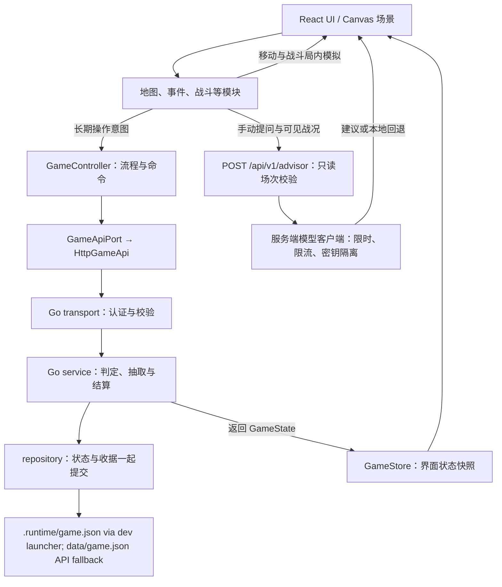
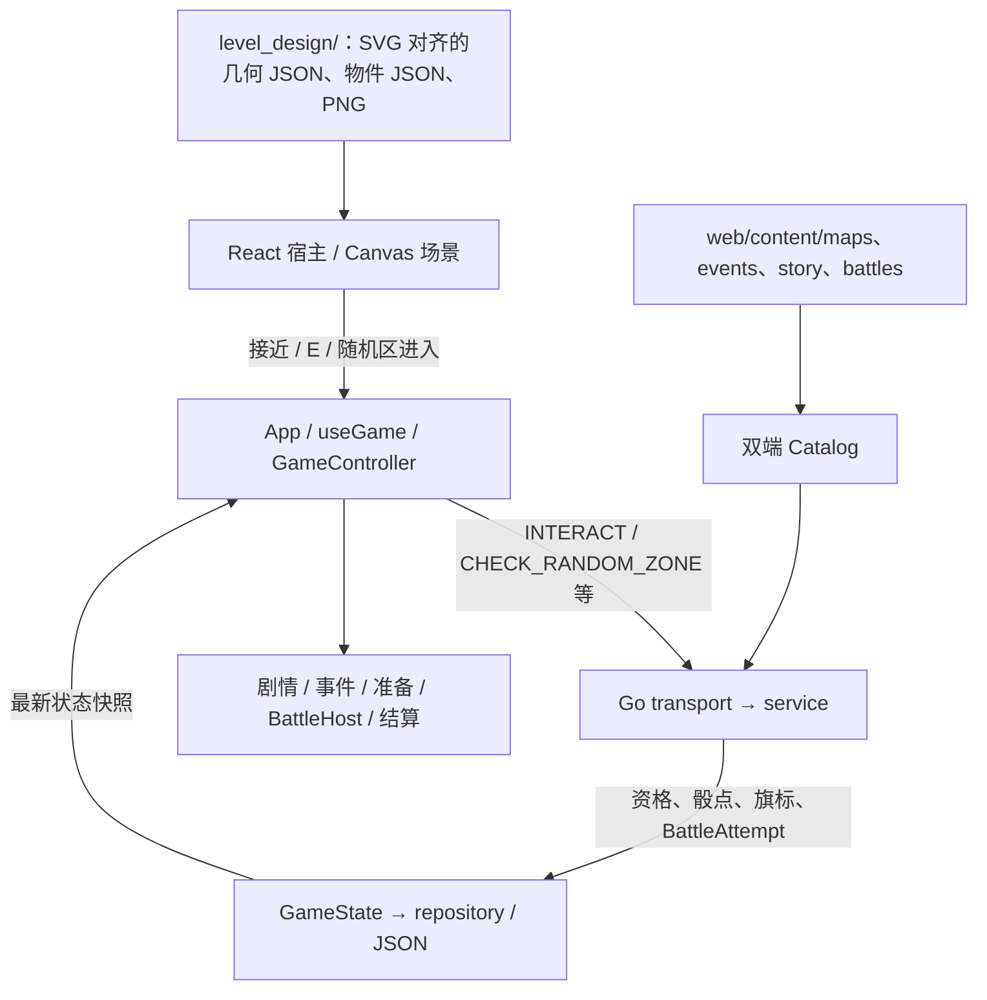

# 架构与文件目录

## 1. 技术与数据流

React + TypeScript + 原生 Canvas 2D；Go API；当前采用单进程 JSON 存档。不使用 Phaser。



移动、碰撞和逐帧战斗在前端运行；事件判定、抽奖、长期奖励、摆放和游戏内家具购买经过 Go。真实付费尚未实现。

## 2. 实际目录

以下从实际源码文件夹生成；node_modules、data、.runtime、output、tmp、构建和测试输出不入库，不列入源码树。预留空目录用 .gitkeep 保留。

```text
stray-kitty/
├─ deploy/  部署模板
│  ├─ team-preview/
│  │  └─ k8s/
│  └─ team-preview-haozhe/
│     ├─ frontend/
│     └─ k8s/
├─ design/  模块设计
│  ├─ events/
│  └─ tower-defense/  塔防规则与关卡规格
│     ├─ art-chapters/
│     └─ levels/
│        ├─ L00-prologue/
│        ├─ L01-first-alley/
│        ├─ L02-midnight-market/  第二章午夜集市设计
│        ├─ L03-abandoned-greenhouse/  第三章废弃花房设计
│        ├─ L04-underground-tunnel/  第四章地下通道设计
│        └─ L05-final-warehouse/  第五章终极仓库设计
├─ docs/  需求、架构、接口与集成记录
│  ├─ ARCHITECTURE.md  架构、目录与接入
│  ├─ BATTLE-ADVISOR-MODEL.md  阿策模型配置、可见战况与回退边界
│  ├─ BATTLE-EVENT-ALLIES.md
│  ├─ BATTLE-EVENT-CARRY.md  事件携带物与协助者六枚举对接
│  ├─ CHAPTER-NAVIGATION-QA.md
│  ├─ DEVELOPMENT.md
│  ├─ GAME-FLOWCHART.html
│  ├─ GAME-FLOWCHART.md
│  ├─ L00-INTEGRATION.md  L00 六波新手教学与接入
│  ├─ L01-INTEGRATION.md  第一章四猫与当前接入
│  ├─ L02-INTEGRATION.md  第二章独立试玩与参数边界
│  ├─ L03-INTEGRATION.md  第三章不规则棋盘与独立试玩边界
│  ├─ L04-INTEGRATION.md  第四章夜视护盾与独立试玩边界
│  ├─ L05-INTEGRATION.md  第五章光路援军与独立试玩边界
│  ├─ LEVEL-EXPLORATION-ARCHITECTURE.md
│  ├─ MAP-QA-FOLLOWUP.md
│  ├─ openapi.json  API 规范
│  ├─ PAYMENT-XSOLLA-SANDBOX.md
│  ├─ PRD.md  需求与分工
│  ├─ STORY-SCRIPT.md
│  └─ STORY-SCRIPT.txt
├─ level_design/
│  ├─ chapter4/
│  │  ├─ art/
│  │  ├─ collision/
│  │  └─ reference/
│  ├─ chapter5/
│  │  ├─ art/
│  │  │  ├─ source/
│  │  │  │  ├─ sprites/
│  │  │  │  └─ stateful/
│  │  │  └─ variants/
│  │  ├─ reference/
│  │  ├─ review/
│  │  ├─ source/
│  │  │  └─ v07/
│  │  └─ tools/
│  ├─ maps/
│  │  └─ reference/
│  ├─ night_market/
│  │  ├─ art/
│  │  └─ design/
│  └─ rainy_alley/
│     ├─ art/
│     ├─ reference/
│     └─ source/
├─ scripts/  启动、生成与检查
├─ server/  Go 服务端
│  ├─ cmd/  服务入口
│  │  ├─ api/  HTTP 启动
│  │  └─ paymentd/
│  ├─ internal/  服务实现
│  │  ├─ advisor/  阿策服务端模型客户端与限流
│  │  ├─ domain/  状态、命令与错误
│  │  ├─ integrations/  外部集成
│  │  │  └─ payment/  独立模拟支付与账本
│  │  ├─ platform/  嵌入内容配置
│  │  ├─ repository/  单进程 JSON 文件事务
│  │  ├─ service/  长期规则、判定、奖励与结算
│  │  └─ transport/  请求、认证与参数检查
│  └─ migrations/  MySQL 结构 · 尚未接入
├─ specs/
│  └─ night-market/
├─ tests/  自动验证
│  ├─ battle/
│  └─ e2e/  浏览器流程
├─ tools/
│  └─ map-review/
│     ├─ chapter1-events/
│     ├─ chapter2/
│     ├─ chapter2-events/
│     ├─ chapter4/
│     ├─ chapter4-events/
│     └─ chapter5-events/
├─ web/  浏览器前端
│  ├─ content/  独立内容数据
│  │  ├─ assets/  素材索引
│  │  ├─ battles/  关卡与波次
│  │  ├─ cats/  猫咪档案
│  │  ├─ economy/  模拟充值商品
│  │  ├─ events/  事件与选项
│  │  ├─ home/  家具与摆放位置
│  │  ├─ items/  道具
│  │  ├─ lottery/  奖池
│  │  ├─ maps/  地图与交互点
│  │  ├─ shop/  家具商品配置
│  │  ├─ story/  章节与对话
│  │  └─ tutorials/  操作提示
│  ├─ public/  静态资源
│  │  └─ assets/  图片、动画、声音与字体
│  │     ├─ home/  无猫建筑、四阶修缮与主题家具透明图集
│  │     │  ├─ parcels/  两套主题的二十四件独立透明家具组件
│  │     │  └─ stages/  四阶段四十八件正向透明家具组件
│  │     └─ night-market/
│  └─ src/  运行代码
│     ├─ adapters/  具体运行能力
│     │  ├─ api/  HTTP 请求
│     │  ├─ canvas/  原生 Canvas 2D
│     │  ├─ payment/  支付动作 · 预留
│     │  ├─ platform/  输入与设备能力
│     │  ├─ storage/  浏览器会话与待确认请求
│     │  └─ telemetry/  本地诊断
│     ├─ app/  启动、装配与 GameController
│     ├─ config/  运行配置
│     ├─ contracts/  公共状态、命令与模块输入输出
│     ├─ core/  公共流程
│     │  ├─ flow/  阶段与命令检查
│     │  ├─ ports/  API 与会话存储接口
│     │  ├─ rules/  公共条件与资源判断
│     │  ├─ state/  GameStore 状态快照
│     │  └─ story/  剧情与任务
│     ├─ examples/  参考实现
│     │  └─ demo/  可替换的贯通 Demo
│     ├─ modules/  正式模块接入口
│     │  ├─ battle/  塔防 · 闫琦雯
│     │  │  ├─ assets/
│     │  │  ├─ chapter/  第一章紧凑棋盘、四猫与固定首领
│     │  │  ├─ finale/  第五章74格仓库、九格终极首领、双精英与固定援军
│     │  │  ├─ greenhouse/  第三章34格不规则棋盘、墨墨与四格荆冠首领
│     │  │  ├─ l00/  固定 L00 局内实现
│     │  │  ├─ market/  第二章六猫、七入口与单格横扫首领
│     │  │  └─ tunnel/  第四章37格不规则暗道、断灯脉冲与墨墨夜视
│     │  ├─ cats/  猫咪档案、救援与成长
│     │  ├─ chapter4/
│     │  ├─ chapter5/
│     │  ├─ economy/  货币、扣费与奖励
│     │  ├─ events/  随机事件 · 余尧
│     │  ├─ home/  家园建设、摆放与互动
│     │  ├─ inventory/  道具与家具持有
│     │  ├─ lottery/  两套主题家具、扭蛋柜台、图鉴与收据
│     │  ├─ map/  地图 · Jenny
│     │  ├─ nightMarket/  Chapter 2 Night Market spatial map and progression
│     │  ├─ qa/  按游戏流程组织的验收操作与服务端能力检查
│     │  ├─ rainyAlley/
│     │  └─ shop/  商品与购买
│     ├─ shared/  通用工具 · 预留
│     └─ ui/  界面与样式 · 轩扬
├─ .dockerignore  容器构建排除
├─ .env.example  非秘密环境变量示例
├─ .gitattributes  换行与二进制规则
├─ .gitignore  本地生成文件排除
├─ .gitlab-ci.yml  检查与构建流水线
├─ 《小猫回家记：流浪猫王国》.md
├─ package-lock.json  锁定依赖
├─ package.json  依赖与工程命令
├─ playwright.config.ts  浏览器测试配置
├─ playwright.player-flow.config.ts
└─ 启动开发.cmd  Windows 开发入口
```

## 3. 状态与模块边界

| 数据 | 放在哪里 |
| --- | --- |
| 长期进度：章节、任务标记、伙伴、资源、家具、摆放、首次奖励与阶段 | 服务端 GameState；前端 GameStore 只保存返回快照 |
| 局内状态：坐标、镜头、敌人、生命、弹道、能量与计时 | 地图／战斗模块内部 |
| 当前面板、选中家具、按钮状态 | React UI |
| 剧情、地图、事件、猫咪、关卡、家具、道具与奖池定义 | web/content |
| 会话与结果未知的原始请求 | adapters/storage；不作为权威存档 |
| 阿策最近三轮手动问答、请求取消状态 | 战斗页面内存；切换场次清空，不写存档 |

home 管自由布置、场景修缮与原猫咪互动，保留十二个旧槽位的兼容入口；lottery 管苔叶来信与月海观星两个主题池（各十二件新家具）、概率、开箱和收据。Go 的 service/lottery.go 在原命令事务内扣费、计保底、补偿重复和签收日常／里程碑奖励；旧家具由剧情确定性赠送。旧存档的 lottery 字段惰性初始化，家具与摆放不重命名。免费池每抽 1 邮票，付费池每抽 60 罐头，最多三抽得未拥有家具；两个池独立累计，历史保留 50 次。模拟支付已有进程内和独立服务两种形态，真实支付尚未接入。

ParcelDialog 在一个电脑端窗口中从左到右提供普通／限定竖排卡池、大尺寸 CapsuleMachine 和 ThemePreview；结果覆盖机器区域，保留底部抽取按钮。主题搭配图使用真实花房建筑与十二件家具，CapsuleCollection 在独立原生 dialog 展示图鉴与单件详情。扭蛋动画依次经过 turning、dropping、opening、result；服务端收据到达后才落蛋和展示家具，减少动态偏好使用短过渡。失败继续使用原重试键，收据回看只显示历史，不提交抽取。抽取、保底与支付接口不变。

花房使用 modules/home 的 assets、layout、objects、painter 共用 1672×941 室内布局：建筑底图与透明组件不含猫咪，HomeMap 和场景使用同一装配；四套阶段家具和独立植物图集的裁切坐标放在模块内的 atlas.json／stage-atlas.json，每种购买家具有独立图稿，默认陈设让位于已保存的摆放。camera 管缩放、拖动与点击坐标转换，navigation 按对象地面占位阻挡，原有像素猫按家具脚点排序，前墙藤蔓和家具前缘独立遮挡。story 在对白期间接管角色和站位，空闲 home 阶段才运行日常行为；四阶外观从既有修缮与终章标记推导，图集仅在需要花房时加载。FurnitureBackpack 通过 DemoScene 的投影与编辑接口在同一张 Canvas 预览本地草稿，底部背包覆盖在原场景上，不重建场景或相机；编辑时暂停并隐藏猫咪，退出后恢复。可选 homeLayout 记录默认及收藏家具的位置与收纳状态，SAVE_HOME_LAYOUT 校验后整批提交。HomeRepairOverlay 将目录 parts 的坐标投影为破损处标记，REPAIR_HOME 的可选 repairId 在服务端校验工程、前置部位与库存，单处扣费并保存到可选 homeRepairs；全部部位修完才写入原阶段 flag。省略 repairId 的旧命令只结算本阶段剩余成本，已完成的阶段 flag 对旧存档继续有效。HomeMap 与现场共享局部修缮后的绘制。

GameScreen 在原顶栏分别提供家园手册、邮局、商店、章节地图、仓库与布置按钮，沿用设置按钮样式，家园顶栏移除资源与充值常驻展示。modules/home/HomeHub 复用居中原生 dialog 容器，每次直接打开对应模块，不再提供统一功能导航；设置保持独立 SettingsPanel。家园手册合并 HomeMap 和共享 JourneyRecord，分类按钮放左、文案放右，伙伴资料集中在猫咪伙伴分类；章节路线使用移除花房图片后的 WorldMap。HomePanel 只处理主线下一步与已解锁故事回顾，关卡试玩由 AcceptancePanel 承接。Modal 的 EmbeddedModalContext 仅消耗一层，供邮局、商店、仓库与补给在各自窗口内复用，家具详情等子弹窗仍为独立原生 dialog。ShopPanel 移除旧家具陈列，使用 lottery/ParcelRewards 签收来信、猫咪心愿与里程碑；该组件沿用原服务端命令与北京时间刷新，ParcelDialog 专注主题池和开箱。货币余额只在使用场景展示；顶栏布置按钮直接使用原 FurnitureBackpack，不修改其画布、相机与保存流程。HomeRepairOverlay 的场景标记保留自身定位变换，不受全局按钮悬停、按下或禁用变换影响。home/renovation 在服务端快照新增修缮部位或提升阶段后，缓存一次旧画面并绘制施工、渐显与暖光；场景在过渡期间暂停猫咪与点击，标记隐藏，完成后恢复。首次加载和家具布置不触发修缮动画，后台或菜单暂停，减少动态偏好使用短淡入。

home/dialogue 按性格、动作和情绪维护台词轮换，reactions 管逐猫摸摸间隔、短时情绪恢复、闲聊节流及家具邀请距离。catPainter 共享正向／逆向身体变换与原猫图稿的透明度命中，picking 检查家具纹理遮挡；点击、拖起和放到伙伴身边共用可见猫判定。鼠标按下命中猫后，松开只处理该猫，防抖期间也不会落到家具邀请。日常状态仅在 Canvas 场景内存中，剧情接管与暂停逻辑保持优先。

## 4. 接入与分工

| 负责人 | 主要位置 | 输入 → 输出 |
| --- | --- | --- |
| 王浩哲 | core/story、core/flow、app；content/story | 状态与剧情节点 → 阶段、任务和跨模块衔接 |
| Jenny | modules/map；content/maps | MapContext → interactionId → INTERACT |
| 余尧 | modules/events；content/events | EventContext → eventId、optionId → CHOOSE_EVENT |
| 闫琦雯 | modules/battle；content/battles | BattleContext → BattleResult → COMPLETE_BATTLE |
| 轩扬 | ui 与各模块展示组件 | 订阅状态、展示结果 → 受控操作回调 |

上表代码路径相对 web/src，内容路径相对 web；战斗引擎、结果结算和联调由闫琦雯维护，家园仓库展示由 UI 协作；其余经济、运维与数据库适配继续按团队认领。app/App.tsx 装配，app/useGame.ts 处理会话、请求和恢复，ui 提供受控展示组件。战斗阶段由 modules/battle/BattleHost.tsx 按场次路由 L00、L01、L02、L03、L04 与 L05 六套实现，其他阶段保留 examples/demo 的探索、地图、家园及剧情场景；其余模块按各自接口继续接入。

- 公共契约在 web/src/contracts/index.ts；长期变更通过 app/controller.ts，不直接修改快照。
- 阿策手动问答走同源只读 API，服务端保管模型配置并在调用前后校验活动场次；只发送可见战况白名单，模型不可用时保留本地规则。自动教学不调用模型，建议不获得游戏操作权限。详见 docs/BATTLE-ADVISOR-MODEL.md。
- 战斗使用服务端 attemptId 和保存的难度快照，七个入口对应六套地图：l00_tutorial 为 3×7／六波教学；alley_rescue 和 alley_boss 共用 5×10 包围框内 26 格／八波四猫首领战；market_boss 为 5×8／八波六猫试玩；greenhouse_boss 为 6×9 包围框内 34 个真实格／八波六猫试玩。L03 缺失格不绘制、不部署、不作为技能中心，墨墨替代点点提供护盾并清除已生成荆棘，四格 Boss 共享体力。tunnel_boss 为 5×8 包围框内 37 格／八波六猫试玩，九处障碍，墨墨以夜视和全员护盾应对断灯；L04 缺失格同样不可绘制、部署或作为技能中心。finale_boss 为 7×12 包围框内 74 格／十波终章试玩，六名可移动主力与三批固定援军，永夜之王占九格，另有两名独立精英；光路随第 3／5／7 波推进，夜视用于暂时识破护幕。
- 新命令无 supplies／usedSupplies；L01–L05 结果包含 leaks 与 bossDefeated，L05 胜负另必报整数 elitesDefeated（0–2），胜利必须为 2，旧章可省略。L02／L03／L04／L05 仅从家园独立进入，完成第一章救援即可分别试玩，不要求按章节顺序先赢前一试玩；胜利只记录本关完成，不发物资、长期伙伴或鼓励奖励，不推进剧情，不清理主线 PendingModifiers。L05 不写终章及建国标记。失败回原关准备并保留失败场次快照，重新挑战创建新 ID、沿用难度；离开准备页清理临时失败身份。
- 所有在场可移动主力猫正常每模拟秒自动 +5 能量（L02 横扫可短暂停止自然蓄能），0 血本场退场，无库存补给或休整。L05 固定援军按间隔自动支援、不能移动或复活，主力六猫全部退场仍判负；灯车与援军不占 carry 通道。L01–L05 另外消费活动场次 carry 的八种事件加成（lantern/mirror/bell/box/dog/dove/rats/kitten），不改基础数值，不恢复背包；L00 忽略 carry。L01 失败准备保留旧 attempt 完整快照，重试创建新 ID 并继承压力和 carry；离开准备清临时身份。暂停与卸载沿用宿主生命周期，刷新同场次从 ready 重建。
- 新增长期规则时同步 Go service、TypeScript 契约与 [OpenAPI](openapi.json)。服务端负责奖励，UI 不直接加余额或发家具。
- 修改内容后执行 npm run content:sync，提交 web/content/catalog.json 和 server/internal/platform/catalog.json 两份生成物。

当前无道具规则与旧预留返还见 [L01 接入](L01-INTEGRATION.md)；序章教程见 [L00 接入](L00-INTEGRATION.md)，第二章七口六猫试玩见 [L02 接入](L02-INTEGRATION.md)，第三章不规则棋盘与墨墨补位见 [L03 接入](L03-INTEGRATION.md)，第四章暗道与夜视护盾见 [L04 接入](L04-INTEGRATION.md)，第五章终极首领、双精英、光路及固定援军见 [L05 接入](L05-INTEGRATION.md)。旧仓库存量保留，新版本不抽取或消耗战斗物品。

### 4.1 关卡探索：当前运行路径

> 技术说明（2026-10-27 基线）。此处只记录地图、事件、剧情和战斗之间的**已实现接口**与**待实现连接**。批准的地图设计资料见 `level_design/`；战斗规则仍由战斗模块维护。



- `web/src/app/App.tsx` 负责组件装配；`web/src/app/useGame.ts` 和 `controller.ts` 负责发命令、请求幂等、存档快照和失败恢复；`web/src/examples/demo/Viewport.tsx` / `scene.ts` 仍是当前探索场景的宿主。**目录名为 demo 不代表雨巷未接入**。
- `web/src/modules/rainyAlley/IntegratedRainyAlley.ts` 负责雨巷玩家局内位置、镜头跟随、输入、接近检测、随机区进入和绘制；`runtimeGeometry.ts` / `collision.ts` 负责碰撞字段、挤窄道及路径规划。地图使用 SVG **来源**的数据，最终运行画面目前仍由 **Canvas 2D** 绘制；不是把 SVG 直接挂载为 DOM 场景。
- 长期状态由 `server/internal/domain/`、`service/`、`repository/` 决定，存于 `data/game.json`；浏览器只缓存最新 `GameState` 快照。帧级移动、相机、角色的局部坐标 **目前不在后端持久化**，不应把恢复 UI 快照误认为已恢复世界坐标。

### 4.2 Rainy Alley：批准空间与资源职责

**批准管线：** v0.4 灰盒 → `rainy_alley_v09.svg` + 对应的 `geometry.json` → 对齐 PNG → `assets.ts` 导入与坐标注册 → Canvas 探索。**禁止按照视觉效果自行更改锁定路网、恢复 Tiled/TMJ 碰撞或另造一份运行时路线。**

| 文件 | 当前用途 |
| --- | --- |
| `level_design/rainy_alley/source/rainy_alley_v09.svg` | 已批准的路网、障碍与设计预览；不直接挂载到浏览器 DOM |
| `level_design/rainy_alley/source/geometry.json` | `1188×726` 世界、walkable/obstacle path、挤道和 `crate-gate-hitbox` 规则 |
| `level_design/rainy_alley/source/level_objects.json` | 固定物件 ID、世界坐标、交互半径、三个随机区及叙事占位点 |
| `level_design/rainy_alley/art/rainy_alley_background.png` | 经批准的 `1672×941` 美术背景，不用颜色判断碰撞 |
| `web/src/modules/rainyAlley/assets.ts` | 导入数据，并维护背景图与世界坐标的统一注册；过滤已完成的物件 |

`geometry.json` 中部分早期 `future_art_registration` 文本仍标记为未注册，但运行时的注册参数已经写在 `assets.ts`；以**正在执行的导入和转换逻辑**为技术事实。今后整理源文件元数据时必须同步，避免误读。若要修改路线本身，必须同时校验 SVG 和 JSON；若只添加门扇开合、攀爬之类的**非碰撞视觉提示**，先放在场景前景层，不改路径拓扑。保留猫的既有像素绘制及摄像机随动。

`alley_rescued` 决定 crate gate 的关闭/打开碰撞状态；雨巷玩家出生点目前在 `IntegratedRainyAlley.ts` 以 `(111,626)` 本地常量定义，画面返回时的位置保持依赖场景实例是否存续。**尚无通用的 `returnAnchorId` / 持久角色坐标契约。** 需要做章节与战斗回归测试，不能假设所有战斗结束后都会自动回到正确入口。

### 4.3 交互与 ID 边界

| 标识符 | 示例 | 谁决定什么 |
| --- | --- | --- |
| `mapId` | `alley`、`market` | `web/content/maps/maps.json`：地图与危险度 |
| `interactionId` | `alley_crate`、`market_crow_stall` | 地图物件/服务器校验的物理交互入口 |
| `eventId` | `crate_event`、`alley_dog_friend` | `web/content/events/events.json`：事件卡、2d6 选项与结果 |
| `zoneId` | `rainy_random_west` | 一次随机事件触发机会，**不是事件卡 ID** |
| `storyNodeId` | `poster_1` | `web/content/story/nodes.json`：对话/分支 |
| `stageId` / `attemptId` | `alley_rescue` / 某次实际战斗 ID | 关卡目录/服务端战斗实例与结果匹配 |
| `flag` | `alley_rescued`、`lost_poster_found` | 服务端持久资格/进度；地图据此改变交互或阻挡 |

地图物件的坐标在 `level_objects.json` 中；已登记的固定事件交互还需在 `web/content/maps/maps.json` 使用相同 `interactionId` 对应已有 `eventId`。**两份文件不会自动互相同步**；检视与单次鱼干、海报属于雨巷专用前后端处理分支，不要求全部添加为事件卡。新增 Old Huang 等节点应复用已有事件 ID，不新建事件规则。

**当前第一章主线入口：** 接近 `alley_crate` → `INTERACT` → `crate_event` 的 `CHOOSE_EVENT` → 战前 `START_BATTLE(alley_rescue)` → `BattleHost` → `COMPLETE_BATTLE` → `CONTINUE` → 后续剧情/地图状态。地图只负责正确触发、暂停探索和战后恢复正确位置/旗标；战斗布阵、敌人、技能、数值与局内完整报告属于战斗团队。

**已发现待统一处：** 救援后 `rescue_1` 可以自动进入 `poster_1`，地图又放置了 `alley_poster` 的实体交互点。必须核对正式剧本的海报揭示设计，再确定是**到海报前按 E 触发**还是自动剧情推进，避免实际标记失去用途。`alley_dog_friend` 和 `momo_trail_event` 的事件卡已见于本次基线，但对应物理锚点尚需实装与服务端注册。

### 4.4 随机事件与 dangerLevel

- 地图表当前为 `alley=1`、`market=2`、`greenhouse=0`、`tunnel=3`、`warehouse=3`。`dangerLevel` 影响**距离触发概率**和**风险/机遇类别权重**，不应被描述成战斗关卡难度。实际权重可来自 `web/content/events/balance.json`/生成后的事件 catalog，回退值来自 `server/internal/service/random.go`。
- 雨巷已有 `rainy_random_west`、`rainy_random_central`、`rainy_random_east` 三个区域：客户端首次进入发送 `CHECK_RANDOM_ZONE`；后端保存 `attempted_<zoneId>` 标志，以 **55%** 做该次触发判断，并过滤不合资格的事件池。雨巷 `REPORT_MOVE` 不再抽事件，避免双触发。
- 其他地图现阶段走 `REPORT_MOVE`：累计每 `150` 单位检查一次，触发后设 `600` 单位保护距离。Night Market 仍用这套机制；图纸中的 R1/R2/R3 只代表候选位置，**并未与服务器 zone 协议连通**。
- 目前后端只白名单验证雨巷三个 `zoneId` 与 `mapId=alley`；**尚未以服务端角色坐标验证实际进入范围**。Night Market 如改用随机区，需扩展地图/区域校验并关闭该图的距离抽取；若采用 L0/L1 实际分层，还需保证区域不跨错层判定。选用距离法、区域法以及高差数量，待 Night Market 路线原型决策。
- 雨巷首次尝试的 `attempted_...` 标志会留在存档；跨重访/章节重复的重置规则**尚未设计为自动清理**。

### 4.5 探索到战斗、返回与跨团队职责

- **地图团队：** 战斗前的空间入口、可见交互提示、允许触发条件、发送现有命令、进入战斗时停止探索输入、战后 `mapId`/出生点/朝向/碰撞正确、已完成物件状态与地图重访。
- **剧情团队：** 哪些节点推进章序、战斗何时强制发生、章末返回何处以及相关 flag 的含义；变更时协调服务器状态转移。
- **事件团队：** 事件卡与区域池、2d6、风险概率和战斗 carry 的产生与结算；地图不复制一套事件随机或奖励逻辑。
- **战斗团队：** 各关的战术棋盘、能力、敌潮、胜负判断和 `BattleReport`。第二章至后续章节的家园试玩入口不等于正式剧情/地图战斗入口。

地图模块的**最小端到端验收**：正确节点进入指定 stage → 探索停止 → 胜利/失败与重试正常回传 → 角色返回可行走位置 → 对应门禁/物件资格更新 → 回访地图和存档恢复不出现错位。若返回锚点需要新 `GameState` 字段，必须同步 Go domain/service/transport、前端 contracts、OpenAPI 与对应测试；不要只在本地 Scene 添加未持久化假字段。

### 4.6 当前章节实现边界（不代替设计决定）

| 章节 | 已经存在 | 仍缺的地图侧能力 |
| --- | --- | --- |
| 第一章 Rainy Alley | SVG-derived 可行走/碰撞、Canvas 摄像机、纸箱战入口、固定事件和三区随机事件 | 视觉门/攀爬提示、Old Huang 锚点、海报交互顺序、主线提示显著性、返回位置 QA |
| 第二章 Night Market | 已批准灰盒和 PNG，当前运行的是简化 Canvas market 场景与 Crow/Pigeon 交互 | 已批准路网的可玩碰撞/导航、决定假高差或 L0/L1、Momo 锚点、随机机制/正式 Boss 入口 |
| 第三章 Greenhouse | 现有可用的 Home/摆放系统与家园试玩 | 属于特殊家园章节；探索式地图是否必要以后单独决定，先保证入口/返回契约 |
| 第四章 Tunnel | 现有叙事与独立战斗试玩 | 地图灰盒、导航/视野提示、剧情触发、正式战斗入口与返回 |

### 4.7 文档与变更约束

第二章事件物件与道路 QA 集成：`nightMarket/eventProps.ts` 将五个固定事件图标绘制到共享的 220×44 缓存画布；`eventLabels.ts` 复用圆角文字缓存与接近淡入逻辑，当前主线目标常显。`DemoScene` 与 `tools/map-review/chapter2-events/` 共用图稿和浮动名称；C/F 提示仅在原有有效距离内显示文字，随机区域不绘制标记。图标不增加图片下载或 API 请求。最新走路 QA 仅扩展第二章南侧弯道、花坛尖端道路及西北屋顶连接的描边；原始 PNG、实物货箱/摊位碰撞、C/F 端点与前置、事件内容和其他章节保持原有行为。

- 本节由 `docs/LEVEL-EXPLORATION-ARCHITECTURE.md` 提供给 `scripts/architecture.mjs` 生成；**勿单独手改生成的 `ARCHITECTURE.md`**。地图制作步骤、审美/灵感材料放在 map 设计文档或个人 Notion，不进入团队架构。
- 改目录后 `npm run architecture:build && npm run architecture:check`；改内容/事件映射跑 `npm run content:sync`、`npm run content:check`，核对双端 catalog；只运行与改动相关的移动/交互/战斗返回冒烟测试。
- 历史章节集成文档保留现状；本节以 inspected baseline 为准，后续主分支变更需再核对。
- 本地端口、worktree 切换、launcher 生命周期与按 worktree 隔离的开发存档见 [本地开发说明](DEVELOPMENT.md)。

### 4.4 Chapter 4 tunnel exploration integration

Chapter 4 exploration is implemented by `web/src/modules/chapter4/TunnelMap.ts` and the canonical package under `level_design/chapter4/`. The two approved raster layers and their grayscale walkability masks are loaded as assets; the map module decodes each mask once and applies the cat footprint during continuous movement. `TunnelWalkableMask` owns point and swept movement validation, including axis sliding at mask edges. Portals and their C/F/Space animations are rendered from the handoff map data. The lighting uses a transparent source-over darkness gradient and screen-blended warm lamp glow; `destination-out` was removed because it erased the approved art and exposed the CSS page background. Handoff opacity, radius, and lamp positions remain unchanged. The optional collision overlay is available only in development builds.

The exploration interaction contract is in `web/content/maps/maps.json`; server event and story progression remains authoritative. The Chapter 4 mainline opens only after the greenhouse progression, reaches exploration through `rescue_intro_1`, requires the trap clue and valve before the boss, returns to authored post-battle story after victory, and does not complete the story on defeat. The pre-existing home `tunnel_boss` trial remains a separate standalone battle path.

`web/src/modules/battle/qa.ts` builds the development-only `QA_SIMULATE_VICTORY` command. `scripts/dev.mjs` enables that command on the local API process; production API processes leave `GAME_QA_ENABLED` unset and reject it. The service derives a valid stage result from the active attempt and routes it through the same battle completion validator as normal callbacks. `import.meta.env.DEV` excludes the control from production builds. The QA path does not directly mutate story flags.

The tunnel's raster world position is runtime-only and returns to its authored spawn after a page refresh. Battle return position and progression state are validated and persisted through the existing server attempt/state flow. This is distinct from persisting free-roam coordinates, which the current exploration API does not provide.

### Chapter 5 warehouse exploration and art review

The development-only `?warehouseWalk=1` entry mounts `WarehouseWalkPreview` with the existing `CanvasViewport` and `DemoScene` input/frame lifecycle. `WarehouseWalkMap` loads the locked v07 floor mask, subtracts all 38 authored solid rectangles and the three initially closed gate rectangles, and reuses swept raster movement with the authored cat radius 13. Prop alpha never determines collision. The existing cat renderer uses 0.75 sprite scale, anchored at its paws, with a closer 680 × 400 camera area. Registered prop components are depth-sorted around the cat. Art registration selects 19 mixed locations by stable seeded SHA-256 ranking and retains 19 single obstacles. Mixed groups use two to five existing sprites with different material themes and independent uniform scales. Selected taller groups declare bounded upward visual height; collision footprints and horizontal/lower art limits are unchanged. The manifest records the seed, themes, rotated natural sizes and visual envelopes. This is fixed art placement, not runtime event randomness.

The same lazy-loaded map now runs for actual `mapId=warehouse` states through the existing `App`/`GameController`/`DemoScene` lifecycle. Separate L0/L1 raster masks use manifest solid rectangles and the six authored elevated regions; only C1/C2 switch layers. The user-requested local solid-edge insets in `level_design/chapter5/playtest_adjustments.json` are applied by the art builder to both artwork and manifest collision, leaving the locked source unchanged. Deck and overhead fascia exports use approved tiled sprite pixels. C/E labels appear near their targets; all four random zones remain invisible. Closed shortcuts and the boss gate use registered mesh barricade assets inside their existing collision footprints and hide when unlocked. All three controllable lamps toggle through the existing interaction command; their existing flags and authored unlock keys control runtime light pools and gate collision; unlit areas are nearly black, with wider, brighter green/orange lamp pools. Event-outcome props are decorative only. Free-roam position/floor remain runtime-only.

`server/internal/service/warehouse.go` validates fixed interactions and random-zone positions against a byte-identical embedded geometry mirror maintained by `scripts/content.mjs`. All four hidden zones roll on entry; the client rearms after exiting with a 12px margin. Misses do not consume a zone, and old persisted zone-attempt records are ignored. The six authored cards retain existing persistent without-replacement records, pending state, outcomes and rewards. The finale introduction stops at exploration, the authored boss starts the existing mainline battle, defeat returns to retry, victory returns through post-battle dialogue to exploration, and the victory-only exit starts the existing ending. Optional fixed events are not prerequisites. Home finale trials retain their independent behavior.

Development `?warehouseQA=1` uses the real reversible `finale.explore` checkpoint; `finale.exit` supports checking the victory exit. The current isolated local session is on 5186/API 8185 with separate QA storage. The older 5185 art comparison has no game session or commands. Focused service/schema/type/build checks and anchor-level browser interactions were run; full route traversal and visual/support approval remain manual. The art registration script and manifests remain under `scripts/register-warehouse-l0.py` and `level_design/chapter5/`; the original JSON/SVG hashes remain locked.

## 5. 启动与检查

环境：Node.js 22.12+、Go 1.24+，无需先安装数据库。

```bash
npm ci
npm run dev
# 页面 http://127.0.0.1:5017；API http://127.0.0.1:8017
npm run check
# 首次安装测试浏览器，然后验证流程
npx playwright install chromium
npm run test:e2e
```

npm run dev 在当前 worktree 使用忽略的 .runtime/game.json；直接运行 API 时默认使用相对 data/game.json，GAME_DATA_FILE 可显式覆盖。不同 worktree 的存档彼此独立，不要合并。浏览器测试用独立端口 8117 和 .runtime/e2e-save.json。环境变量示例见 .env.example，程序读取进程环境变量，不自动加载 .env。端口冲突诊断、启动/停止、切换 worktree 与安全清理步骤见 [本地开发说明](DEVELOPMENT.md)。

当前存档只支持单进程，MySQL 只有 DDL；战斗胜负仍由客户端原型上报。Docker、K8s 与 GitLab CI 是待团队环境验证的模板。GitLab main 已采用本架构；旧 main 保存在 react-demo 分支，历史不变。

## 6. react-demo 接入记录

来源：[轩扬的 react-demo 原型](https://school-gitlab.xsolla.dev/haozhe_wang/stray-kitty/-/tree/react-demo)，基准提交 b740853；以下为在新架构中的移植，原分支未修改。

| 原型内容 | 当前入口与变化 |
| --- | --- |
| 开场、红蓝黄视觉、像素猫 | ui/StartScreen.tsx、ui/styles.css、ui/PixelCat.tsx；Canvas 与 UI 共用 adapters/canvas/pixelCat.ts 的原像素造型 |
| App / Zustand 状态 | app/App.tsx 与 app/useGame.ts；统一经过 GameController、GameStore、GameApiPort；不导入第二套游戏状态机 |
| 对话与寻猫启事 | content/story/nodes.json 与 ui/DialoguePanel.tsx；保留既有节点 ID 和存档字段，追加兼容节点 |
| 骰子界面 | ui/DiceEvent.tsx；选择后请求 CHOOSE_EVENT，Go 决定骰点；界面不随机发奖 |
| 章节地图 | ui/WorldMap.tsx；读取 Catalog 和真实解锁状态，路线切换仍走 GO_HOME / GO_EXPLORE |
| 家具商店 | ui/ShopPanel.tsx、content/shop/products.json、service/shop.go；新增 BUY_FURNITURE，单件购买、服务端定价、校验、扣费和发货，复用事务与幂等收据 |
| 获救伙伴与结算 | ui/GameScreen.tsx；伙伴与首次奖励读取 GameState，不再使用静态解锁或固定结算 |
| 探索与塔防 | 探索保留 examples/demo 的 Canvas 场景；战斗由 BattleHost 路由 L00–L05 六套模块，不覆盖探索／家园画面；未导入旧原型的 onComplete 无条件胜利接口 |

地图和商店采用原生 dialog，打开时暂停局内模拟；Escape 关闭、焦点约束和关闭后恢复焦点。返回标题保留存档，刷新后可继续；待确认的请求仍按原幂等键重试。新增商品与剧情为兼容内容补充，沿用当前 contentVersion，不清空已有玩家。

## 7. 余尧事件设计 v0.3 接入

来源：[余尧 MR !1](https://school-gitlab.xsolla.dev/haozhe_wang/stray-kitty/-/merge_requests/1)，提交 410fae4 的 docs/random-events-design.md。原交付为设计文档；本仓库把判定与跨模块衔接落成参考实现，事件模块与正式卡片内容仍由余尧负责。

- **已接入**：服务端独立掷两颗 D6；12 大成功、9–11 成功、6–8 有代价、2–5 失败推进。四档概率依次 1/36、9/36、16/36、10/36；12 不重复计入普通成功。
- **四通道 Outcome**：reward 的 fish → inventory.food、stamps → currencies.stamp、clue / material → inventory 同名键；tdMod.shadowPressure → 下场战斗的 modifiers；situation → 指定的衔接剧情；flags → 长期剧情标记。骰点、资源、后果与收据一起保存。
- **局势已运行**：参考纸箱卡的绕路 / 紧急撤离先进入配置指定的剧情节点，确认后进入 preparation；失败仍能营救点点。寻猫启事按固定剧情节拍出现，推进时记录 lost_poster_found，不进随机池。
- **塔防接入**：START_BATTLE 保留 activeBattle.modifiers 字段，事件修正随场次保存。事件侧负责判断档位，各章宿主将场次 shadowPressure 的 -1／0／1 转为 low／medium／high，缺省普通、非法值拒绝；不随最新 EventState 改档。L00 首次教学固定普通，失败重试复制旧场次快照，结算不消费待用修正。L01 胜利清空待用修正。L02／L03／L04／L05 独立试玩可快照已有压力，但胜负均保留主线 PendingModifiers，重试沿用失败场次难度。战斗侧只应用一次三档敌人体力倍率，不重新评分，也不叠加旧 Demo 压力速度倍率。
- **代码位置**：contracts/index.ts 公共契约；modules/events/types.ts、presentation.ts 接入与展示映射；content/events/events.json 三个选项 × 四档参考后果；Go domain/events.go 判定；service/events.go 原子结算与剧情衔接；ui/DiceEvent.tsx、EventResult.tsx 双骰与后果展示。
- **只预留，尚未运行**：MapDefinition.dangerLevel 0–3（现为示例配置）、节点 / 随机触发类型与已抽事件 ID 输入。区域无放回随机池、触发频率与类型配比、半秒预告、伙伴技能、强制后续事件及其余正式事件卡待余尧与地图 / UI 负责人继续接入；未将 10 张设计目标写成已完成内容。
- **兼容与分工**：保留原 crate_event、search / comfort 标识，新增 eventState 和 battle.modifiers 均为可选字段；旧单骰存档仍可继续，旧 event_success 加成仅为旧战斗保留。当前沿用内容版本；新增参考卡文案、危险度和压力数值均是接入样例，正式定稿由原模块负责人维护。原 MR 和分支未修改，未自动合并。

## 8. 2.0.0 / MR !2 的兼容移植

来源：[轩扬 MR !2「小猫回家记 2.0.0」](https://school-gitlab.xsolla.dev/haozhe_wang/stray-kitty/-/merge_requests/2)，参考提交 a553076。分支以 e0676ab 为共同基点，恢复了旧根目录 src、Vite 入口和 package.json，原 MR 未自动合并。

| 新内容 | 接入位置与处理 |
| --- | --- |
| 暮色菜单、城市 / 树林 / 花房 / 路灯 | ui/StartMenuBackdrop.tsx、ui/StartScreen.tsx，纯展示层，不管理会话与存档 |
| 纸木色、森林绿、灯光金主题 | ui/theme-cozy.css；适配当前布局，单独导入，未叠加原分支七层主题文件 |
| 更细致的 64×64 猫咪 | adapters/canvas/pixelCat.ts 的共享路径；ui/PixelCat.tsx 渲染 SVG，CanvasPainter 按同一图稿绘制；浏览器保留矢量清晰度 |
| 望京 SOHO 风格像素城市 | 作者 StartBackdrop.jsx 导出为 public/assets/city-backdrop.svg，并登记素材目录；参考小巷 Canvas 加载为背景层，移动边界、障碍物、观察点和纸箱坐标保持现有配置 |
| 四档事件 UI | 颜色与布局接入现有 DiceEvent / EventResult；仍读取 Go 返回的两颗骰子与 Outcome |

两处兼容取舍：原分支的团子为暹罗猫，而当前剧情、档案与王浩哲新增文案均为橘猫，因此保留橘猫身份、移植新造型与条纹；原 eventRules.js 明确是临时适配器，采用加成及 12/8/5 阈值，继续由当前 Go 的无加成 12/9/6 四档判定统一结算。

当前入口、workspace 工程命令、JSON 存档、服务端定价与发货、双骰后果包均保留。王浩哲新增的序章、对话态度、环境观察及 protect 事件选项继续运行。外部库不增加 Zustand 或 Framer Motion。MR 的旧状态机、临时结算、根目录工程配置与旧剧情数据未纳入本次移植。

## 9. 当前战斗集成

当前已有 L00–L05 六套战斗地图、七个服务入口。正式序章 l00_tutorial 使用五步教学与六波实战；第一章首次救援 alley_rescue 与家园 alley_boss 共用四猫首领战。家园 market_boss、greenhouse_boss、tunnel_boss 和 finale_boss 分别提供第二至第五章独立试玩，不插入正式主线，不清理主线待用压力。L03 保留原图 34 格不规则边界，点点本章留守，墨墨以护盾与清棘补位；本关名单不改长期招募或其他模块故事。L04 的 tunnel_boss 另提供地下通道独立试玩：37 格不规则边界，六猫含点点与墨墨，A2 暗管绕 A1/B1/C1 接近 C2。四格首领断灯脉冲暂时限制远处小怪可见性，所有猫保持可见且照常作战；墨墨本章以夜视加全员护盾应对。第三章技能不变。

L05 的 finale_boss 使用 74 格不规则仓库、十波 44 小怪、九格永夜之王和两名各自计血的精英护卫。团子、点点、墨墨与绒绒、斑斑、栗栗构成六名主力；铃铃、桃桃、音音于第 3／5／7 波从固定位置支援，不能移动、复活或代替主力全退场判负。灯车同期推进光路，墨墨夜视识破首领护幕并提供全队护盾，不复用第四章断灯。结算除了 Boss 本体还必须报告 elitesDefeated，胜利要求两精英均败；十波普通敌人仍须全部生成处理。终章正式接点仅列为 finale_intro_5 → 战斗 → finale_intro_6 的候选，不写 finale_started／finale_completed／kingdom_founded。

所有已实现章节无库存补给、休整或同场复活，主力技能使用自然蓄能；第一章起额外接收事件来源的单个 carry，六枚举、第一版效果与生命周期见 [事件战斗对接](BATTLE-EVENT-CARRY.md)。旧 active 预留在新版结算时全额返还且只执行一次。公共规则和各章设计见 [塔防索引](../design/tower-defense/README.md)。

目录变化后运行 npm run architecture:build；npm run architecture:check 会检查本文件与实际文件夹是否一致。需求见 [PRD](PRD.md)。
