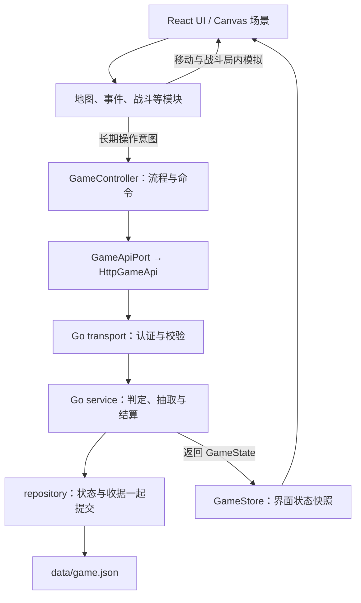

# 架构与文件目录

## 1. 技术与数据流

React + TypeScript + 原生 Canvas 2D；Go API；当前采用单进程 JSON 存档。不使用 Phaser。



移动、碰撞和逐帧战斗在前端运行；事件判定、抽奖、长期奖励、摆放和游戏内家具购买经过 Go。真实付费尚未实现。

## 2. 实际目录

以下从实际源码文件夹生成；node_modules、data、.runtime、output、tmp、构建和测试输出不入库，不列入源码树。预留空目录用 .gitkeep 保留。

```text
stray-kitty/
├─ deploy/  部署模板
├─ design/
│  └─ events/
├─ docs/  仅三份文档
│  ├─ ARCHITECTURE.md  架构、目录与接入
│  ├─ openapi.json  API 规范
│  └─ PRD.md  需求与分工
├─ scripts/  启动、生成与检查
├─ server/  Go 服务端
│  ├─ cmd/  服务入口
│  │  └─ api/  HTTP 启动
│  ├─ internal/  服务实现
│  │  ├─ domain/  状态、命令与错误
│  │  ├─ integrations/  外部集成
│  │  │  └─ payment/  支付渠道 · 预留
│  │  ├─ platform/  嵌入内容配置
│  │  ├─ repository/  单进程 JSON 文件事务
│  │  ├─ service/  长期规则、判定、奖励与结算
│  │  └─ transport/  请求、认证与参数检查
│  └─ migrations/  MySQL 结构 · 尚未接入
├─ tests/  自动验证
│  └─ e2e/  浏览器流程
├─ web/  浏览器前端
│  ├─ content/  独立内容数据
│  │  ├─ assets/  素材索引
│  │  ├─ battles/  关卡与波次
│  │  ├─ cats/  猫咪档案
│  │  ├─ economy/  经济配置 · 预留
│  │  ├─ events/  事件与选项
│  │  ├─ home/  家具与摆放位置
│  │  ├─ items/  道具
│  │  ├─ lottery/  奖池
│  │  ├─ maps/  地图与交互点
│  │  ├─ shop/  家具商品配置
│  │  ├─ story/  章节与对话
│  │  └─ tutorials/  操作提示
│  ├─ public/  静态资源
│  │  └─ assets/  图片、动画、声音与字体
│  └─ src/  运行代码
│     ├─ adapters/  具体运行能力
│     │  ├─ api/  HTTP 请求
│     │  ├─ canvas/  原生 Canvas 2D
│     │  ├─ payment/  支付动作 · 预留
│     │  ├─ platform/  输入与设备能力
│     │  ├─ storage/  浏览器会话与待确认请求
│     │  └─ telemetry/  本地诊断
│     ├─ app/  启动、装配与 GameController
│     ├─ config/  运行配置
│     ├─ contracts/  公共状态、命令与模块输入输出
│     ├─ core/  公共流程
│     │  ├─ flow/  阶段与命令检查
│     │  ├─ ports/  API 与会话存储接口
│     │  ├─ rules/  公共条件与资源判断
│     │  ├─ state/  GameStore 状态快照
│     │  └─ story/  剧情与任务
│     ├─ examples/  参考实现
│     │  └─ demo/  可替换的贯通 Demo
│     ├─ modules/  正式模块接入口
│     │  ├─ battle/  塔防 · 闫琦雯
│     │  ├─ cats/  猫咪档案、救援与成长
│     │  ├─ economy/  货币、扣费与奖励
│     │  ├─ events/  随机事件 · 余尧
│     │  ├─ home/  家园建设、摆放与互动
│     │  ├─ inventory/  道具与家具持有
│     │  ├─ lottery/  奖池、抽取与结果
│     │  ├─ map/  地图 · Jenny
│     │  └─ shop/  商品与购买
│     ├─ shared/  通用工具 · 预留
│     └─ ui/  界面与样式 · 轩扬
├─ .dockerignore  容器构建排除
├─ .env.example  非秘密环境变量示例
├─ .gitattributes  换行与二进制规则
├─ .gitignore  本地生成文件排除
├─ .gitlab-ci.yml  检查与构建流水线
├─ 《小猫回家记：流浪猫王国》.md
├─ package-lock.json  锁定依赖
├─ package.json  依赖与工程命令
├─ playwright.config.ts  浏览器测试配置
└─ 启动开发.cmd  Windows 开发入口
```

## 3. 状态与模块边界

| 数据 | 放在哪里 |
| --- | --- |
| 长期进度：章节、任务标记、伙伴、资源、家具、摆放、首次奖励与阶段 | 服务端 GameState；前端 GameStore 只保存返回快照 |
| 局内状态：坐标、镜头、敌人、生命、弹道、能量与计时 | 地图／战斗模块内部 |
| 当前面板、选中家具、按钮状态 | React UI |
| 剧情、地图、事件、猫咪、关卡、家具、道具与奖池定义 | web/content |
| 会话与结果未知的原始请求 | adapters/storage；不作为权威存档 |

home 管建设与摆放，lottery 管抽奖，shop 管购买；economy 统一余额与结算，inventory 统一拥有状态。抽到／买到家具后再交 home 摆放。真实付费预留在前后端 payment 目录，本次没有支付实现。

## 4. 接入与分工

| 负责人 | 主要位置 | 输入 → 输出 |
| --- | --- | --- |
| 王浩哲 | core/story、core/flow、app；content/story | 状态与剧情节点 → 阶段、任务和跨模块衔接 |
| Jenny | modules/map；content/maps | MapContext → interactionId → INTERACT |
| 余尧 | modules/events；content/events | EventContext → eventId、optionId → CHOOSE_EVENT |
| 闫琦雯 | modules/battle；content/battles | BattleContext → BattleResult → COMPLETE_BATTLE |
| 轩扬 | ui 与各模块展示组件 | 订阅状态、展示结果 → 受控操作回调 |

上表代码路径相对 web/src，内容路径相对 web；其他模块扩展待认领。modules 当前主要提供 types.ts 接口；app/App.tsx 装配，app/useGame.ts 处理会话、请求和恢复，ui 提供受控展示组件，examples/demo 保留可替换的 Canvas 地图与塔防样例。各成员在本人模块开发，完成后逐个替换对应部分。

- 公共契约在 web/src/contracts/index.ts；长期变更通过 app/controller.ts，不直接修改快照。
- 战斗输入包含服务端 attemptId、关卡、伙伴和事件效果；输出 attemptId 与 won/lost。正式模块实现 start、pause、stop，退出释放监听与计时器。
- 新增长期规则时同步 Go service、TypeScript 契约与 [OpenAPI](openapi.json)。服务端负责奖励，UI 不直接加余额或发家具。
- 修改内容后执行 npm run content:sync，提交 web/content/catalog.json 和 server/internal/platform/catalog.json 两份生成物。

## 5. 启动与检查

环境：Node.js 22.12+、Go 1.24+，无需先安装数据库。

```bash
npm ci
npm run dev
# 页面 http://127.0.0.1:5017；API http://127.0.0.1:8017
npm run check
# 首次安装测试浏览器，然后验证流程
npx playwright install chromium
npm run test:e2e
```

开发存档在 data/game.json；浏览器测试用独立端口 8117 和 .runtime/e2e-save.json。环境变量示例见 .env.example，程序读取进程环境变量，不自动加载 .env。

当前存档只支持单进程，MySQL 只有 DDL；战斗胜负仍由客户端原型上报。Docker、K8s 与 GitLab CI 是待团队环境验证的模板。GitLab main 已采用本架构；旧 main 保存在 react-demo 分支，历史不变。

## 6. react-demo 接入记录

来源：[轩扬的 react-demo 原型](https://school-gitlab.xsolla.dev/haozhe_wang/stray-kitty/-/tree/react-demo)，基准提交 b740853；以下为在新架构中的移植，原分支未修改。

| 原型内容 | 当前入口与变化 |
| --- | --- |
| 开场、红蓝黄视觉、像素猫 | ui/StartScreen.tsx、ui/styles.css、ui/PixelCat.tsx；Canvas 与 UI 共用 adapters/canvas/pixelCat.ts 的原像素造型 |
| App / Zustand 状态 | app/App.tsx 与 app/useGame.ts；统一经过 GameController、GameStore、GameApiPort；不导入第二套游戏状态机 |
| 对话与寻猫启事 | content/story/nodes.json 与 ui/DialoguePanel.tsx；保留既有节点 ID 和存档字段，追加兼容节点 |
| 骰子界面 | ui/DiceEvent.tsx；选择后请求 CHOOSE_EVENT，Go 决定骰点；界面不随机发奖 |
| 章节地图 | ui/WorldMap.tsx；读取 Catalog 和真实解锁状态，路线切换仍走 GO_HOME / GO_EXPLORE |
| 家具商店 | ui/ShopPanel.tsx、content/shop/products.json、service/shop.go；新增 BUY_FURNITURE，单件购买、服务端定价、校验、扣费和发货，复用事务与幂等收据 |
| 获救伙伴与结算 | ui/GameScreen.tsx；伙伴与首次奖励读取 GameState，不再使用静态解锁或固定结算 |
| 探索与塔防 | 保留 examples/demo 的 Canvas 自由移动和战斗模拟；未导入旧原型的独立计时器与 onComplete 无条件胜利接口；正式替换仍由 Jenny、闫琦雯负责 |

地图和商店采用原生 dialog，打开时暂停局内模拟；Escape 关闭、焦点约束和关闭后恢复焦点。返回标题保留存档，刷新后可继续；待确认的请求仍按原幂等键重试。新增商品与剧情为兼容内容补充，沿用当前 contentVersion，不清空已有玩家。

## 7. 余尧事件设计 v0.3 接入

来源：[余尧 MR !1](https://school-gitlab.xsolla.dev/haozhe_wang/stray-kitty/-/merge_requests/1)，提交 410fae4 的 docs/random-events-design.md。原交付为设计文档；本仓库把判定与跨模块衔接落成参考实现，事件模块与正式卡片内容仍由余尧负责。

- **已接入**：服务端独立掷两颗 D6；12 大成功、9–11 成功、6–8 有代价、2–5 失败推进。四档概率依次 1/36、9/36、16/36、10/36；12 不重复计入普通成功。
- **四通道 Outcome**：reward 的 fish → inventory.food、stamps → currencies.stamp、clue / material → inventory 同名键；tdMod.shadowPressure → 下场战斗的 modifiers；situation → 指定的衔接剧情；flags → 长期剧情标记。骰点、资源、后果与收据一起保存。
- **局势已运行**：参考纸箱卡的绕路 / 紧急撤离先进入配置指定的剧情节点，确认后进入 preparation；失败仍能营救点点。寻猫启事按固定剧情节拍出现，推进时记录 lost_poster_found，不进随机池。
- **塔防接入**：START_BATTLE 把待应用修正快照到 activeBattle.modifiers；参考模拟把黑影移动速度调整为基础速度的 80% / 100% / 120%。失败重试保留后果，成功后清除待应用修正；正式数值交闫琦雯确认。
- **代码位置**：contracts/index.ts 公共契约；modules/events/types.ts、presentation.ts 接入与展示映射；content/events/events.json 三个选项 × 四档参考后果；Go domain/events.go 判定；service/events.go 原子结算与剧情衔接；ui/DiceEvent.tsx、EventResult.tsx 双骰与后果展示。
- **只预留，尚未运行**：MapDefinition.dangerLevel 0–3（现为示例配置）、节点 / 随机触发类型与已抽事件 ID 输入。区域无放回随机池、触发频率与类型配比、半秒预告、伙伴技能、强制后续事件及其余正式事件卡待余尧与地图 / UI 负责人继续接入；未将 10 张设计目标写成已完成内容。
- **兼容与分工**：保留原 crate_event、search / comfort 标识，新增 eventState 和 battle.modifiers 均为可选字段；旧单骰存档仍可继续，旧 event_success 加成仅为旧战斗保留。当前沿用内容版本；新增参考卡文案、危险度和压力数值均是接入样例，正式定稿由原模块负责人维护。原 MR 和分支未修改，未自动合并。

## 8. 2.0.0 / MR !2 的兼容移植

来源：[轩扬 MR !2「小猫回家记 2.0.0」](https://school-gitlab.xsolla.dev/haozhe_wang/stray-kitty/-/merge_requests/2)，参考提交 a553076。分支以 e0676ab 为共同基点，恢复了旧根目录 src、Vite 入口和 package.json，原 MR 未自动合并。

| 新内容 | 接入位置与处理 |
| --- | --- |
| 暮色菜单、城市 / 树林 / 花房 / 路灯 | ui/StartMenuBackdrop.tsx、ui/StartScreen.tsx，纯展示层，不管理会话与存档 |
| 纸木色、森林绿、灯光金主题 | ui/theme-cozy.css；适配当前布局，单独导入，未叠加原分支七层主题文件 |
| 更细致的 64×64 猫咪 | adapters/canvas/pixelCat.ts 的共享路径；ui/PixelCat.tsx 渲染 SVG，CanvasPainter 按同一图稿绘制；浏览器保留矢量清晰度 |
| 望京 SOHO 风格像素城市 | 作者 StartBackdrop.jsx 导出为 public/assets/city-backdrop.svg，并登记素材目录；参考小巷 Canvas 加载为背景层，移动边界、障碍物、观察点和纸箱坐标保持现有配置 |
| 四档事件 UI | 颜色与布局接入现有 DiceEvent / EventResult；仍读取 Go 返回的两颗骰子与 Outcome |

两处兼容取舍：原分支的团子为暹罗猫，而当前剧情、档案与王浩哲新增文案均为橘猫，因此保留橘猫身份、移植新造型与条纹；原 eventRules.js 明确是临时适配器，采用加成及 12/8/5 阈值，继续由当前 Go 的无加成 12/9/6 四档判定统一结算。

当前入口、workspace 工程命令、JSON 存档、服务端定价与发货、双骰后果包均保留。王浩哲新增的序章、对话态度、环境观察及 protect 事件选项继续运行。外部库不增加 Zustand 或 Framer Motion。MR 的旧状态机、临时结算、根目录工程配置与旧剧情数据未纳入本次移植。

目录变化后运行 npm run architecture:build；npm run architecture:check 会检查本文件与实际文件夹是否一致。需求见 [PRD](PRD.md)。
