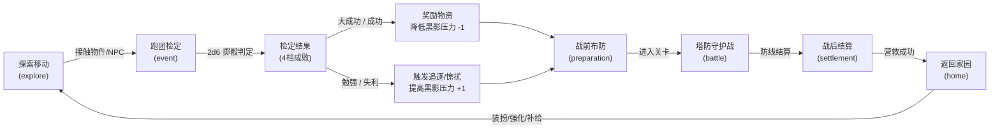

# 《小猫回家记：流浪猫王国》全流程结构与系统流程图

> **主线流程设计**：王浩哲  
> **文档版本**：v1.0 完结收官版  
> **核心循环**：`主线叙事 ➔ 场景探索 ➔ 跑团抉择 (2d6) ➔ 战术守护 (TD) ➔ 救助安顿 ➔ 家园营建 ➔ 章节跃迁`

---

## 1. 全局主线全景流程图（序章至终章）

```mermaid
flowchart TD
    %% 阶段节点定义
    subgraph S0["【序章：金枪鱼事件 · 独对暗影】（地图：雨夜小巷 alley）"]
        A1["主线叙事 dialogue<br/>追寻金枪鱼香味走失 · 暴雨初临孤独无助"] --> A2["暗影逼近 dialogue<br/>小巷深处异响 · 喵喵勇敢点亮第一道微光"]
        A2 --> A3["L00 初光防线教学战 battle<br/>熟悉 3×7 棋盘 · 部署/治疗/蓄能/战术技能"]
        A3 --> A4["初战胜利结算 settlement<br/>驱散先头黑影 · 守住窗外第一道防线"]
    end

    subgraph S1["【第一章：陌生小巷 · 纸箱救援】（地图：雨夜小巷 alley）"]
        A4 --> B1["团子循光而至 dialogue<br/>初遇热心橘猫团子 · 结伴探寻雨巷"]
        B1 --> B2["雨巷自由探索 explore<br/>按键穿越窄道 · 寻找微弱喵声来源"]
        B2 --> B3["发现受困纸箱 interact<br/>遭遇点点 · 触发纸箱抉择事件"]
        B3 --> B4["双骰跑团检定 event<br/>2d6 掷骰判定 · 四档结果影响黑影攻击烈度"]
        B4 --> B5["战前准备布防 preparation<br/>规划点点撤离路线 · 携带光源与补给"]
        B5 --> B6["小巷守护战 battle<br/>Stage: alley_rescue · 三路布防击溃暗影波次"]
        B6 --> B7["救援胜利结算 settlement<br/>点点加入队伍 · 获纸箱猫窝、邮票与材料"]
        B7 --> B8["寻猫启事与营地提议 dialogue<br/>墙角发现寻猫启事 · 伙伴提议前往废弃温室花房"]
    end

    subgraph S2["【家园建设：废弃花房大本营】（地图：温室花房 greenhouse）"]
        B8 --> C1["花房庇护所落成 home<br/>伙伴初次安顿 · 避风港建立"]
        C1 --> C2["家园修缮与布置<br/>角落放置纸箱猫窝 · 窗边摆放蓝色饭碗"]
        C1 --> C3["猫国商店与雨夜包裹<br/>消耗猫爪邮票采购家具 · 抽取装饰物件"]
        C1 --> C4["自由往返与整装启程<br/>随时返回小巷 / 集市 / 暗道继续冒险"]
    end

    subgraph S3["【第二章：午夜集市 · 传闻与线索】（地图：午夜集市 market）"]
        C4 --> D1["集市启程剧情 dialogue<br/>小队踏入神秘地下猫市 · 探寻暗影秘密"]
        D1 --> D2["立体街市探索 explore<br/>在货箱台阶、遮阳雨棚与石砖街道穿行"]
        D2 --> D3["老黑羽情报摊 interact / event<br/>与乌鸦商人讲价 · 掷骰打听失踪猫咪去向"]
        D2 --> D4["咕咕大盗传言棚 interact / event<br/>与鸽子探子盘旋交涉 · 探查地下暗道入口"]
        D3 & D4 --> D5["暗影渗透警报 preparation<br/>集市深处黑影逼近 · 规划集市防御路线"]
        D5 --> D6["午夜集市保卫战 battle<br/>Stage: market_boss · 六猫布防七入口 · 击退集市首领"]
        D6 --> D7["集市保卫战胜利 settlement<br/>击溃黑影 · 满载情报与物资返回花房大本营"]
    end

    subgraph S4["【第三章：废弃花房 · 要塞防线】（地图：温室花房 greenhouse）"]
        D7 --> E1["第三章启程 dialogue<br/>黑猫墨墨潜行而至 · 带来暗影老巢动向"]
        E1 --> E2["花房修缮与战前动员 dialogue<br/>greenhouse_intro_7 · 战前墨墨正式入队 momo_joined"]
        E2 --> E3["花房要塞保卫战 battle<br/>Stage: greenhouse_boss · 墨墨巡光护盾铲荆棘 · 击退四格首领"]
        E3 --> E4["花房要塞保卫战胜利 settlement<br/>防线经受考验 · 要塞正式加固 greenhouse_fortified"]
    end

    subgraph S5["【第四章：消失的猫咪们 · 暗道侦查】（地图：地下暗道 tunnel）"]
        E4 --> F1["深入暗道剧情 dialogue<br/>从花房后井下潜暗渠 · 墨墨绿眸暗处引路"]
        F1 --> F2["排污蓄水管道探索 explore<br/>在潮湿暗渠管道与生锈铁阀间摸索推进"]
        F2 --> F3["识破发条诱饵与黑影突袭 dialogue<br/>灭灯危急时刻 · 墨墨觉醒夜视与全员护盾 rescue_intro_9"]
        F3 --> F4["地下暗道破袭战 battle<br/>Stage: tunnel_boss · 夜视破除断灯 · 击溃暗渠首领"]
        F4 --> F5["合力冲破泄洪铁闸门 settlement / dialogue<br/>rescue_intro_10 · 救出第一批幼猫 cats_rescued_batch1"]
    end

    subgraph S6["【终章：点亮流浪猫王国 · 终战与大团圆】（场景：大仓库 / 花房）"]
        F5 --> G1["进军废弃总仓库 dialogue<br/>最后一批伙伴困于深层防空隔间 · 黑影重重封锁"]
        G1 --> G2["吹响冲锋号角 dialogue<br/>finale_intro_5 喵喵挺身号召冲锋 · 战术准备 finale_boss"]
        G2 --> G3["大仓库光之决战 battle<br/>Stage: finale_boss · 移动灯具推进 · 击败永夜之王与两名精英"]
        G3 --> G4["强光破暗 · 全员突围 dialogue<br/>finale_intro_6 破开铁锁循光撤离 ➔ 7~9 幕大团圆结局"]
        G4 --> G5["流浪猫王国落成庆典 home<br/>finale_completed · kingdom_founded · 喵喵双重归宿"]
    end

    %% 章节流转与闭环连接
    C4 -.-> D1
    D7 -.-> E1
    E4 -.-> F1
    F5 -.-> G1

    %% 阶段样式
    style S0 fill:#f0f7ff,stroke:#2b6cb0,stroke-width:2px
    style S1 fill:#fffaf0,stroke:#dd6b20,stroke-width:2px
    style S2 fill:#f0fff4,stroke:#2f855a,stroke-width:2px
    style S3 fill:#fff5f5,stroke:#c53030,stroke-width:2px
    style S4 fill:#f7fafc,stroke:#4a5568,stroke-width:2px
    style S5 fill:#edf2f7,stroke:#2d3748,stroke-width:2px
    style S6 fill:#fffff0,stroke:#d69e2e,stroke-width:2px
```

---

## 2. 核心单循环玩法模型（Game Loop）

---

## 3. 章节核心要素与状态标记对照表（State Flags DAG）

| 章节编号与名称 | 主要场景 | 主线正式战斗与触发/衔接接点 | 核心角色行动与流程 | 产生的关键 State Flags | 解锁的家园与系统要素 |
| :--- | :--- | :--- | :--- | :--- | :--- |
| **序章** · 金枪鱼事件 | 雨夜小巷 (`alley`) | `l00_tutorial` 接点：`prologue_advisor` → 战斗 → `chapter1_intro` | 喵喵遭遇暗影遇险，伙伴救场引导初光防线教学 | `l00_tutorial` `l00_completed` | 激活移动与基础交互能力 |
| **第一章** · 陌生小巷 | 雨夜小巷 (`alley`) | `alley_rescue` / `alley_boss` 接点：`crate_event` (接应出箱) → 战斗 → `rescue_1` | 结识团子，接应暹罗点点出纸箱并合力守住撤离路线 | `alley_rescued` `rescue_story_done` | 点点正式入队、纸箱猫窝、解锁花房大本营 |
| **第二章** · 午夜集市 | 午夜集市 (`market`) | `market_boss` (L02) 接点：集市探索收集情报后 → 战斗 → 战后返程 | 与老黑羽、咕咕大盗交涉暗影线索，六猫守住集市7入口 | `market_unlocked` `chapter_2_started` `market_cleared` | 猫国商店商品扩充、集市物资兑换、开启第三章剧情 |
| **第三章** · 废弃花房 | 温室花房 (`greenhouse`) | `greenhouse_boss` (L03) 接点：`greenhouse_intro_7` → 战斗 → 战后庆功 | 墨墨加入编队替代点点，全员防守34格通路铲荆棘 | **战前**：`momo_joined` **战后**：`greenhouse_fortified` | 墨墨正式入队出战、花房要塞加固完成、解锁第四章暗道 |
| **第四章** · 消失的猫咪们 | 地下暗道 (`tunnel`) | `tunnel_boss` (L04) 接点：`rescue_intro_9` → 战斗 → `rescue_intro_10` | 破除发条诱饵，墨墨觉醒夜视护盾，破开铁栓救出幼猫 | **战前**：墨墨觉醒夜视 **战后**：`tunnel_explored` `cats_rescued_batch1` | 暗道地图全通、锁定大仓库坐标 |
| **终章** · 点亮流浪猫王国 | 废弃大仓库 / 花房 | `finale_boss` (L05) 接点：`finale_intro_5` → 战斗 → `finale_intro_6` | 聚光推进，击退永夜之王与双精英，受困猫全员突围 | **战后**：`finale_started` `finale_completed` `kingdom_founded` | 全剧终金色庆典、窗前暖光串灯、街坊水粮补给、与主人团聚 |
