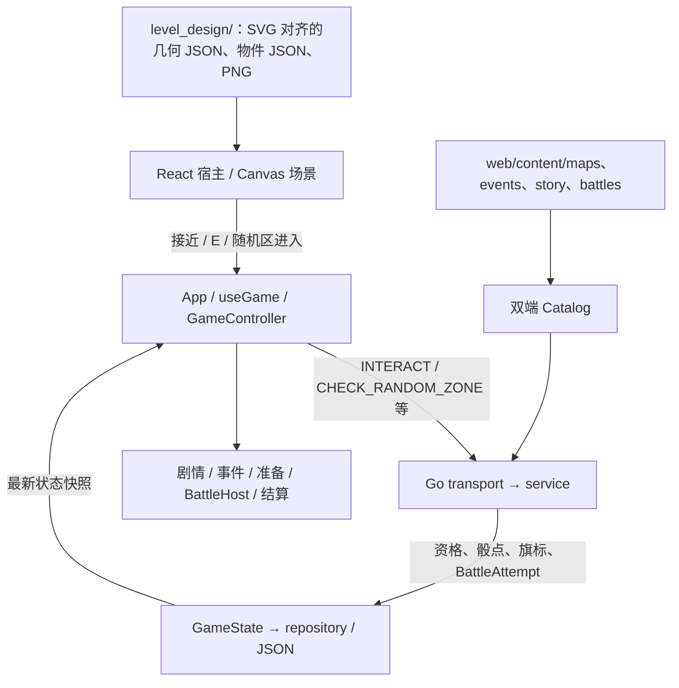

### 4.1 关卡探索：当前运行路径

> 技术说明（2026-10-27 基线）。此处只记录地图、事件、剧情和战斗之间的**已实现接口**与**待实现连接**。批准的地图设计资料见 `level_design/`；战斗规则仍由战斗模块维护。

- `web/src/app/App.tsx` 负责组件装配；`web/src/app/useGame.ts` 和 `controller.ts` 负责发命令、请求幂等、存档快照和失败恢复；`web/src/examples/demo/Viewport.tsx` / `scene.ts` 仍是当前探索场景的宿主。**目录名为 demo 不代表雨巷未接入**。
- `web/src/modules/rainyAlley/IntegratedRainyAlley.ts` 负责雨巷玩家局内位置、镜头跟随、输入、接近检测、随机区进入和绘制；`runtimeGeometry.ts` / `collision.ts` 负责碰撞字段、挤窄道及路径规划。地图使用 SVG **来源**的数据，最终运行画面目前仍由 **Canvas 2D** 绘制；不是把 SVG 直接挂载为 DOM 场景。
- 长期状态由 `server/internal/domain/`、`service/`、`repository/` 决定，存于 `data/game.json`；浏览器只缓存最新 `GameState` 快照。帧级移动、相机、角色的局部坐标 **目前不在后端持久化**，不应把恢复 UI 快照误认为已恢复世界坐标。

### 4.2 Rainy Alley：批准空间与资源职责

**批准管线：** v0.4 灰盒 → `rainy_alley_v09.svg` + 对应的 `geometry.json` → 对齐 PNG → `assets.ts` 导入与坐标注册 → Canvas 探索。**禁止按照视觉效果自行更改锁定路网、恢复 Tiled/TMJ 碰撞或另造一份运行时路线。**

| 文件 | 当前用途 |
| --- | --- |
| `level_design/rainy_alley/source/rainy_alley_v09.svg` | 已批准的路网、障碍与设计预览；不直接挂载到浏览器 DOM |
| `level_design/rainy_alley/source/geometry.json` | `1188×726` 世界、walkable/obstacle path、挤道和 `crate-gate-hitbox` 规则 |
| `level_design/rainy_alley/source/level_objects.json` | 固定物件 ID、世界坐标、交互半径、三个随机区及叙事占位点 |
| `level_design/rainy_alley/art/rainy_alley_background.png` | 经批准的 `1672×941` 美术背景，不用颜色判断碰撞 |
| `web/src/modules/rainyAlley/assets.ts` | 导入数据，并维护背景图与世界坐标的统一注册；过滤已完成的物件 |

`geometry.json` 中部分早期 `future_art_registration` 文本仍标记为未注册，但运行时的注册参数已经写在 `assets.ts`；以**正在执行的导入和转换逻辑**为技术事实。今后整理源文件元数据时必须同步，避免误读。若要修改路线本身，必须同时校验 SVG 和 JSON；若只添加门扇开合、攀爬之类的**非碰撞视觉提示**，先放在场景前景层，不改路径拓扑。保留猫的既有像素绘制及摄像机随动。

`alley_rescued` 决定 crate gate 的关闭/打开碰撞状态；雨巷玩家出生点目前在 `IntegratedRainyAlley.ts` 以 `(111,626)` 本地常量定义，画面返回时的位置保持依赖场景实例是否存续。**尚无通用的 `returnAnchorId` / 持久角色坐标契约。** 需要做章节与战斗回归测试，不能假设所有战斗结束后都会自动回到正确入口。

### 4.3 交互与 ID 边界

| 标识符 | 示例 | 谁决定什么 |
| --- | --- | --- |
| `mapId` | `alley`、`market` | `web/content/maps/maps.json`：地图与危险度 |
| `interactionId` | `alley_crate`、`market_crow_stall` | 地图物件/服务器校验的物理交互入口 |
| `eventId` | `crate_event`、`alley_dog_friend` | `web/content/events/events.json`：事件卡、2d6 选项与结果 |
| `zoneId` | `rainy_random_west` | 一次随机事件触发机会，**不是事件卡 ID** |
| `storyNodeId` | `poster_1` | `web/content/story/nodes.json`：对话/分支 |
| `stageId` / `attemptId` | `alley_rescue` / 某次实际战斗 ID | 关卡目录/服务端战斗实例与结果匹配 |
| `flag` | `alley_rescued`、`lost_poster_found` | 服务端持久资格/进度；地图据此改变交互或阻挡 |

地图物件的坐标在 `level_objects.json` 中；已登记的固定事件交互还需在 `web/content/maps/maps.json` 使用相同 `interactionId` 对应已有 `eventId`。**两份文件不会自动互相同步**；检视与单次鱼干、海报属于雨巷专用前后端处理分支，不要求全部添加为事件卡。新增 Old Huang 等节点应复用已有事件 ID，不新建事件规则。

**当前第一章主线入口：** 接近 `alley_crate` → `INTERACT` → `crate_event` 的 `CHOOSE_EVENT` → 战前 `START_BATTLE(alley_rescue)` → `BattleHost` → `COMPLETE_BATTLE` → `CONTINUE` → 后续剧情/地图状态。地图只负责正确触发、暂停探索和战后恢复正确位置/旗标；战斗布阵、敌人、技能、数值与局内完整报告属于战斗团队。

**已发现待统一处：** 救援后 `rescue_1` 可以自动进入 `poster_1`，地图又放置了 `alley_poster` 的实体交互点。必须核对正式剧本的海报揭示设计，再确定是**到海报前按 E 触发**还是自动剧情推进，避免实际标记失去用途。`alley_dog_friend` 和 `momo_trail_event` 的事件卡已见于本次基线，但对应物理锚点尚需实装与服务端注册。

### 4.4 随机事件与 dangerLevel

- 地图表当前为 `alley=1`、`market=2`、`greenhouse=0`、`tunnel=3`、`warehouse=3`。`dangerLevel` 影响**距离触发概率**和**风险/机遇类别权重**，不应被描述成战斗关卡难度。实际权重可来自 `web/content/events/balance.json`/生成后的事件 catalog，回退值来自 `server/internal/service/random.go`。
- 雨巷已有 `rainy_random_west`、`rainy_random_central`、`rainy_random_east` 三个区域：客户端首次进入发送 `CHECK_RANDOM_ZONE`；后端保存 `attempted_<zoneId>` 标志，以 **55%** 做该次触发判断，并过滤不合资格的事件池。雨巷 `REPORT_MOVE` 不再抽事件，避免双触发。
- 其他地图现阶段走 `REPORT_MOVE`：累计每 `150` 单位检查一次，触发后设 `600` 单位保护距离。Night Market 仍用这套机制；图纸中的 R1/R2/R3 只代表候选位置，**并未与服务器 zone 协议连通**。
- 目前后端只白名单验证雨巷三个 `zoneId` 与 `mapId=alley`；**尚未以服务端角色坐标验证实际进入范围**。Night Market 如改用随机区，需扩展地图/区域校验并关闭该图的距离抽取；若采用 L0/L1 实际分层，还需保证区域不跨错层判定。选用距离法、区域法以及高差数量，待 Night Market 路线原型决策。
- 雨巷首次尝试的 `attempted_...` 标志会留在存档；跨重访/章节重复的重置规则**尚未设计为自动清理**。

### 4.5 探索到战斗、返回与跨团队职责

- **地图团队：** 战斗前的空间入口、可见交互提示、允许触发条件、发送现有命令、进入战斗时停止探索输入、战后 `mapId`/出生点/朝向/碰撞正确、已完成物件状态与地图重访。
- **剧情团队：** 哪些节点推进章序、战斗何时强制发生、章末返回何处以及相关 flag 的含义；变更时协调服务器状态转移。
- **事件团队：** 事件卡与区域池、2d6、风险概率和战斗 carry 的产生与结算；地图不复制一套事件随机或奖励逻辑。
- **战斗团队：** 各关的战术棋盘、能力、敌潮、胜负判断和 `BattleReport`。第二章至后续章节的家园试玩入口不等于正式剧情/地图战斗入口。

地图模块的**最小端到端验收**：正确节点进入指定 stage → 探索停止 → 胜利/失败与重试正常回传 → 角色返回可行走位置 → 对应门禁/物件资格更新 → 回访地图和存档恢复不出现错位。若返回锚点需要新 `GameState` 字段，必须同步 Go domain/service/transport、前端 contracts、OpenAPI 与对应测试；不要只在本地 Scene 添加未持久化假字段。

### 4.6 当前章节实现边界（不代替设计决定）

| 章节 | 已经存在 | 仍缺的地图侧能力 |
| --- | --- | --- |
| 第一章 Rainy Alley | SVG-derived 可行走/碰撞、Canvas 摄像机、纸箱战入口、固定事件和三区随机事件 | 视觉门/攀爬提示、Old Huang 锚点、海报交互顺序、主线提示显著性、返回位置 QA |
| 第二章 Night Market | 已批准灰盒和 PNG，当前运行的是简化 Canvas market 场景与 Crow/Pigeon 交互 | 已批准路网的可玩碰撞/导航、决定假高差或 L0/L1、Momo 锚点、随机机制/正式 Boss 入口 |
| 第三章 Greenhouse | 现有可用的 Home/摆放系统与家园试玩 | 属于特殊家园章节；探索式地图是否必要以后单独决定，先保证入口/返回契约 |
| 第四章 Tunnel | 现有叙事与独立战斗试玩 | 地图灰盒、导航/视野提示、剧情触发、正式战斗入口与返回 |

### 4.7 文档与变更约束

第二章事件物件与道路 QA 集成：`nightMarket/eventProps.ts` 将五个固定事件图标绘制到共享的 220×44 缓存画布；`eventLabels.ts` 复用圆角文字缓存与接近淡入逻辑，当前主线目标常显。`DemoScene` 与 `tools/map-review/chapter2-events/` 共用图稿和浮动名称；C/F 提示仅在原有有效距离内显示文字，随机区域不绘制标记。图标不增加图片下载或 API 请求。最新走路 QA 仅扩展第二章南侧弯道、花坛尖端道路及西北屋顶连接的描边；原始 PNG、实物货箱/摊位碰撞、C/F 端点与前置、事件内容和其他章节保持原有行为。

- 本节由 `docs/LEVEL-EXPLORATION-ARCHITECTURE.md` 提供给 `scripts/architecture.mjs` 生成；**勿单独手改生成的 `ARCHITECTURE.md`**。地图制作步骤、审美/灵感材料放在 map 设计文档或个人 Notion，不进入团队架构。
- 改目录后 `npm run architecture:build && npm run architecture:check`；改内容/事件映射跑 `npm run content:sync`、`npm run content:check`，核对双端 catalog；只运行与改动相关的移动/交互/战斗返回冒烟测试。
- 历史章节集成文档保留现状；本节以 inspected baseline 为准，后续主分支变更需再核对。
- 本地端口、worktree 切换、launcher 生命周期与按 worktree 隔离的开发存档见 [本地开发说明](DEVELOPMENT.md)。

### 4.4 Chapter 4 tunnel exploration integration

Chapter 4 exploration is implemented by `web/src/modules/chapter4/TunnelMap.ts` and the canonical package under `level_design/chapter4/`. The two approved raster layers and their grayscale walkability masks are loaded as assets; the map module decodes each mask once and applies the cat footprint during continuous movement. `TunnelWalkableMask` owns point and swept movement validation, including axis sliding at mask edges. Portals and their C/F/Space animations are rendered from the handoff map data. The lighting uses a transparent source-over darkness gradient and screen-blended warm lamp glow; `destination-out` was removed because it erased the approved art and exposed the CSS page background. Handoff opacity, radius, and lamp positions remain unchanged. The optional collision overlay is available only in development builds.

The exploration interaction contract is in `web/content/maps/maps.json`; server event and story progression remains authoritative. The Chapter 4 mainline opens only after the greenhouse progression, reaches exploration through `rescue_intro_1`, requires the trap clue and valve before the boss, returns to authored post-battle story after victory, and does not complete the story on defeat. The pre-existing home `tunnel_boss` trial remains a separate standalone battle path.

`web/src/modules/battle/qa.ts` builds the development-only `QA_SIMULATE_VICTORY` command. `scripts/dev.mjs` enables that command on the local API process; production API processes leave `GAME_QA_ENABLED` unset and reject it. The service derives a valid stage result from the active attempt and routes it through the same battle completion validator as normal callbacks. `import.meta.env.DEV` excludes the control from production builds. The QA path does not directly mutate story flags.

The tunnel's raster world position is runtime-only and returns to its authored spawn after a page refresh. Battle return position and progression state are validated and persisted through the existing server attempt/state flow. This is distinct from persisting free-roam coordinates, which the current exploration API does not provide.

### Chapter 5 warehouse exploration and art review

The development-only `?warehouseWalk=1` entry mounts `WarehouseWalkPreview` with the existing `CanvasViewport` and `DemoScene` input/frame lifecycle. `WarehouseWalkMap` loads the locked v07 floor mask, subtracts all 38 authored solid rectangles and the three initially closed gate rectangles, and reuses swept raster movement with the authored cat radius 13. Prop alpha never determines collision. The existing cat renderer uses 0.75 sprite scale, anchored at its paws, with a closer 680 × 400 camera area. Registered prop components are depth-sorted around the cat. Art registration selects 19 mixed locations by stable seeded SHA-256 ranking and retains 19 single obstacles. Mixed groups use two to five existing sprites with different material themes and independent uniform scales. Selected taller groups declare bounded upward visual height; collision footprints and horizontal/lower art limits are unchanged. The manifest records the seed, themes, rotated natural sizes and visual envelopes. This is fixed art placement, not runtime event randomness.

The same map code is bundled with the main game entry to avoid retired-chunk requests from open tabs, and runs for actual `mapId=warehouse` states through the existing `App`/`GameController`/`DemoScene` lifecycle. Separate L0/L1 raster masks use manifest solid rectangles and the six authored elevated regions; only C1/C2 switch layers. The user-requested local solid-edge insets in `level_design/chapter5/playtest_adjustments.json` are applied by the art builder to both artwork and manifest collision, leaving the locked source unchanged. Deck and overhead fascia exports use approved tiled sprite pixels. C/E labels appear near their targets; all four random zones remain invisible. Closed shortcuts and the boss gate use registered mesh barricade assets inside their existing collision footprints and hide when unlocked. All three controllable lamps toggle through the existing interaction command; their existing flags and authored unlock keys control runtime light pools and gate collision; unlit areas are nearly black, with wider, brighter green/orange lamp pools. Event-outcome props are decorative only. Free-roam position/floor remain runtime-only.

`server/internal/service/warehouse.go` validates fixed interactions and random-zone positions against a byte-identical embedded geometry mirror maintained by `scripts/content.mjs`. All four hidden zones roll on entry; the client rearms after exiting with a 12px margin. Misses do not consume a zone, and old persisted zone-attempt records are ignored. The six authored cards retain existing persistent without-replacement records, pending state, outcomes and rewards. The finale introduction stops at exploration, the authored boss starts the existing mainline battle, defeat returns to retry, victory returns through post-battle dialogue to exploration, and the victory-only exit starts the existing ending. Optional fixed events are not prerequisites. Home finale trials retain their independent behavior.

Development `?warehouseQA=1` uses the real reversible `finale.explore` checkpoint; `finale.exit` supports checking the victory exit. The current isolated local session is on 5186/API 8185 with separate QA storage. The older 5185 art comparison has no game session or commands. Focused service/schema/type/build checks and anchor-level browser interactions were run; full route traversal and visual/support approval remain manual. The art registration script and manifests remain under `scripts/register-warehouse-l0.py` and `level_design/chapter5/`; the original JSON/SVG hashes remain locked.
